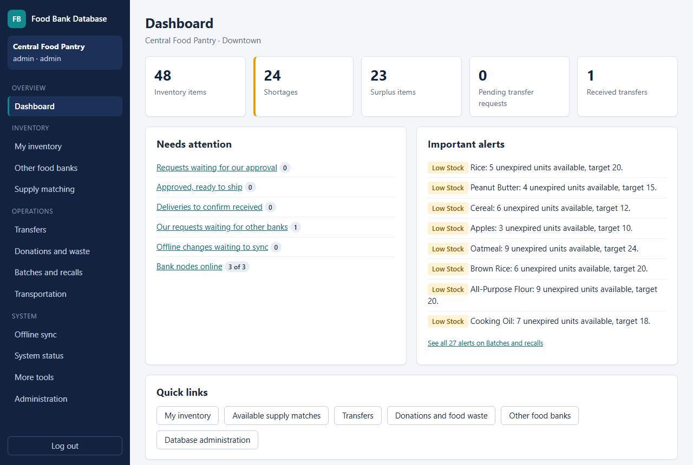
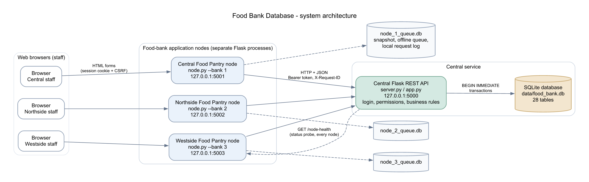
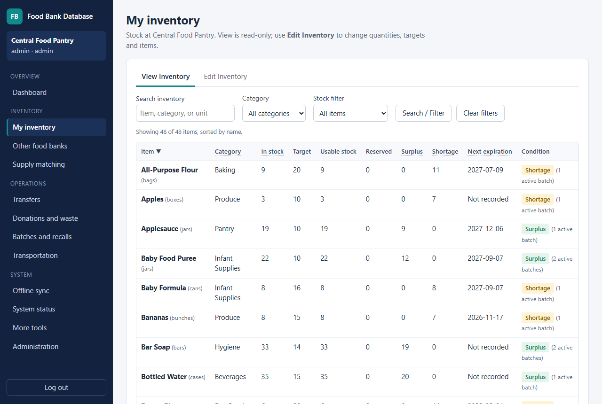
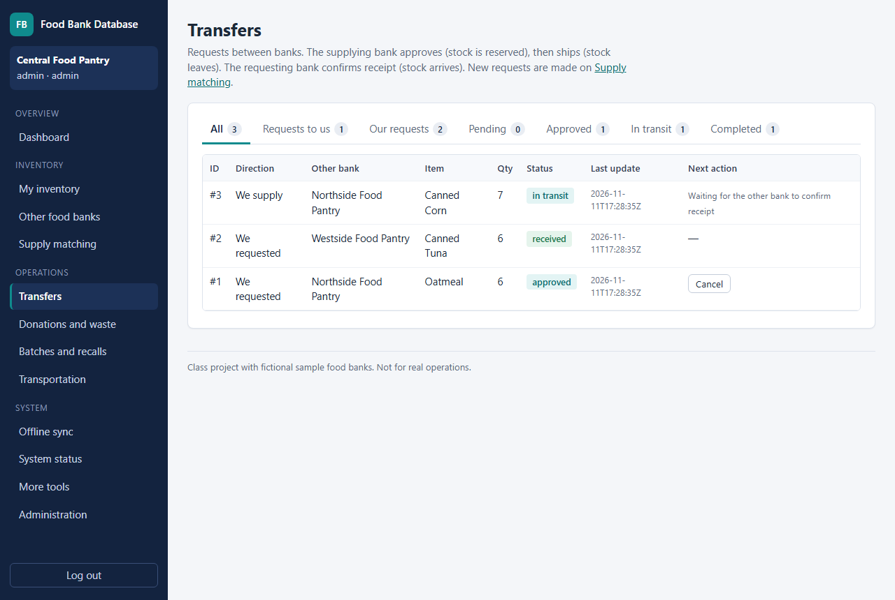
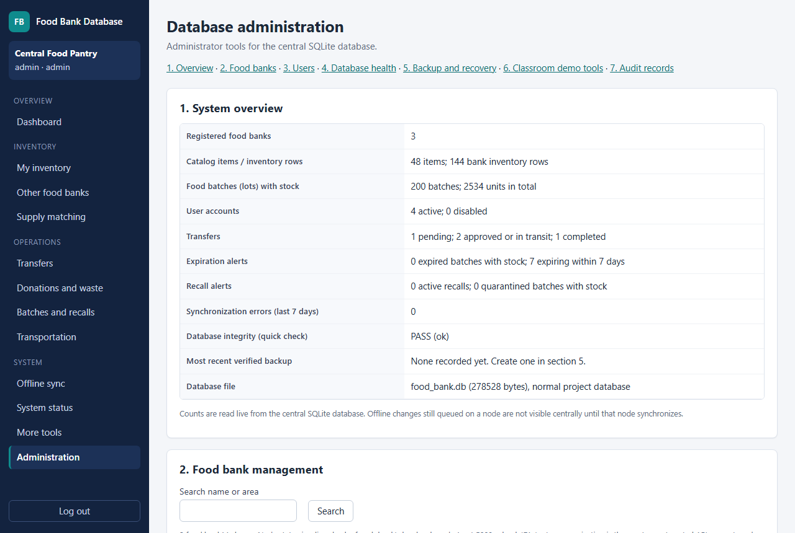

# Food Bank Management System

A distributed computing course project that lets several food banks track their own inventory, find shortages and surpluses, and move food between each other. Each food bank runs its own web application node, and every node talks to one central REST API over HTTP and JSON.

**Team:** Kaitlin Albey, Alec Fox, Corey Rodgers, Daniel Aldama, Brenden Riddle
**Team repository:** https://github.com/kaitlinalbey/food-bank

> This is a classroom prototype. It uses fictional food banks, fictional donors and public demo passwords. Do not enter real donor, client or staff information, and do not run it on a public network.



## Contents

1. [Overview](#1-overview)
2. [Problem and purpose](#2-problem-and-purpose)
3. [Main features](#3-main-features)
4. [System architecture](#4-system-architecture)
5. [Technologies used](#5-technologies-used)
6. [Installation](#6-installation)
7. [Starting the application](#7-starting-the-application)
8. [Using the web interface](#8-using-the-web-interface)
9. [User roles and permissions](#9-user-roles-and-permissions)
10. [Testing](#10-testing)
11. [Known limitations](#11-known-limitations)
12. [Future improvements](#12-future-improvements)
13. [Project structure and further documentation](#13-project-structure-and-further-documentation)

## 1. Overview

The system has two kinds of processes:

- a **central API** (`server.py`), which owns the SQLite database and enforces every business rule, and
- three **food-bank nodes** (`node.py`), one per food bank. Each node is a separate Flask website that staff use in a browser. A node never opens the central database. It asks the API for everything.

The sample setup has three fictional food banks (Central, Northside and Westside Food Pantry), 48 catalog items, 200 stock batches and a few example transfers. The web interface is labelled "Food Bank Database".

## 2. Problem and purpose

Food banks often have too much of one item and not enough of another, while a food bank a few miles away has the opposite problem. Finding a partner usually takes phone calls and emails, and short-dated food can expire while that happens.

This project gives each food bank a shared view of where extra stock is. It also gives them a controlled way to request, approve, ship and receive transfers. For the course, the main goal was to build separate communicating processes and handle the problems that come with that: network failures, retries, two users changing the same data at once, and keeping stock counts correct.

## 3. Main features

Every feature listed here is in the code and is covered by the automated tests or the scripted walkthrough (`verify_ui.py`).

**Inventory and expiration tracking**
- Per-bank inventory with target levels, search, category and stock-status filters, and column sorting.
- Stock is stored in batches (lots) with expiration dates and lot codes. Batches can be filtered by expiring, expired and recalled.
- **Usable stock** counts only batches that are not expired and not recalled. Shortages, surpluses and matching are calculated from usable stock, so expired or recalled food never hides a shortage.
- A batch's expiration date can be corrected from a plain HTML form that works without JavaScript.

**Recalls and storage**
- An administrator can issue a recall for a lot code. Matching batches are quarantined at every bank, including stock already in transit.
- Storage zones (`ambient`, `refrigerated`, `frozen`) have capacity limits. The node and the API accept only these three storage types.

**Matching and transfers**
- **Supply matching** lists each shortage next to other banks' usable surplus, with straight-line distance and a simple score.
- Transfers follow the states `pending → approved → in_transit → received`. A pending request can be declined, or cancelled by the requesting bank.
- Approving reserves stock. Shipping removes it from the supplier, and receiving adds it to the requester. Partial receipts record damaged or missing units.

**Other records**
- Donations, donor directory, printable donation receipts and waste reports.
- Pickup and delivery schedules, drivers, vehicles and transport assignments.
- CSV import and export, barcode lookup, physical counts that a manager approves, and a simple 30-day usage forecast.

**Distributed system behaviour**
- Node health is shown on the Dashboard and System status pages.
- When the central API is unreachable, a node shows its last saved inventory snapshot and lets staff queue stock adjustments and donation receipts. These sync later.
- Request keys and operation keys prevent a retried request from being applied twice.
- Version checks reject an offline change that was made against out-of-date data.
- Each request carries a correlation ID that both the node and the API log, so a request can be traced.

**Administration**
- A Database administration page (admin only) for live counts, food bank and user management, a database health check, verified backups and isolated restore tests.
- A Distributed System Test Lab (admin only) that runs 8 fault scenarios on temporary databases.

## 4. System architecture



| Component | File(s) | Port | Responsibility |
| --- | --- | --- | --- |
| Central API | `server.py`, `app.py`, `routes/`, `services/` | 5000 | Login, permissions, inventory and transfer rules. The only process that opens the main database. |
| Food-bank node | `node.py`, `templates/`, `static/` | 5001-5003 | Server-rendered web pages for one bank. It calls the API for every read and write. |
| Node offline store | `offline_queue.py` | — | A small per-node SQLite file with the last inventory snapshot, queued offline changes and a request log. |
| Database | `database.py`, `phase3_schema.py` | — | One SQLite file with 28 tables, created and upgraded without dropping data. |

The central API is a **single point of failure**. This is a deliberate simplification for a classroom project, and it is discussed in [Known limitations](#11-known-limitations). More detail is in [docs/ARCHITECTURE.md](docs/ARCHITECTURE.md), and the full schema is in [docs/DATABASE_DICTIONARY.md](docs/DATABASE_DICTIONARY.md).

## 5. Technologies used

| Part | Technology |
| --- | --- |
| Language | Python 3.10+ (tested with 3.12 and 3.13) |
| Web framework | Flask 3, for both the API and the nodes |
| Templates | Jinja2, server-rendered HTML with one stylesheet (no JavaScript framework) |
| Database | SQLite (Python standard library) |
| Node-to-API communication | HTTP and JSON with Python's `urllib` |
| Testing | Python `unittest`, plus scripts that start the real processes |
| Containers (optional) | Docker and Docker Compose |

Flask is the only third-party dependency (`requirements.txt`).

## 6. Installation

**Requirements**

- Python 3.10 or newer. On Windows, tick "Add Python to PATH" during installation.
- Free local ports 5000, 5001, 5002 and 5003.
- An internet connection the first time, so Flask can be installed.
- Optional: Docker Desktop.

**Get the code**

```bash
git clone <repository-url> food-bank-management-system
cd food-bank-management-system
```

**Windows (simplest).** No extra steps. The launchers in the next section create a `.venv` virtual environment and install Flask the first time they run.

**Manual setup (Windows, macOS or Linux)**

```bash
python -m venv .venv
# Windows:      .venv\Scripts\activate
# macOS/Linux:  source .venv/bin/activate
python -m pip install -r requirements.txt
```

**Configuration.** The application needs no configuration file and no secrets to run the demo. All settings are optional environment variables, and [.env.example](.env.example) lists them with their defaults. The project does not load `.env` files automatically. Set the variables in your shell if you need them.

## 7. Starting the application

**Option A: Windows launcher (recommended for a demo).** Double-click `run_presentation_windows.bat`. It starts the API and three nodes with a brand-new copy of the fictional sample data under `data/presentation_sessions/`. Leave the terminal open, and press **Ctrl+C** to stop all four processes.

`run_windows.bat` does the same, but keeps its data in `data/food_bank.db` between runs.

**Option B: any operating system.** With the virtual environment active:

```bash
python start_presentation.py   # fresh demo data each run (same as run_presentation_windows.bat)
python start_demo.py           # persistent data/food_bank.db (same as run_windows.bat)
```

Both scripts turn on classroom demo mode (`FOOD_BANK_DEMO_MODE=1`). This creates the demo accounts below. Without demo mode, a new database gets no accounts, and you create an administrator with `python manage_accounts.py create-admin --bank 1 --username <name>`.

**Option C: Docker Compose.**

```bash
docker compose up --build
docker compose down        # stop; add -v to also delete the demo data volume
```

The containers bind only to `127.0.0.1` and use the same ports.

**Check that it is running:** http://127.0.0.1:5000/api/health should return `{"service": "food-bank-central-api", "status": "ok"}`.

## 8. Using the web interface

| Food bank node | Address |
| --- | --- |
| Central Food Pantry | http://127.0.0.1:5001 |
| Northside Food Pantry | http://127.0.0.1:5002 |
| Westside Food Pantry | http://127.0.0.1:5003 |
| API reference page | http://127.0.0.1:5000/docs |

**Demo accounts (demo mode only):**

| Node | Username | Password | Role |
| --- | --- | --- | --- |
| Any of the three | `staff` | `demo123` | staff |
| Central (5001) | `admin` | `admin123` | admin |

These passwords are public on purpose. When demo mode is off, the API refuses them.

After you log in, the left sidebar links to every page: **Dashboard**, **My inventory**, **Other food banks**, **Supply matching**, **Transfers**, **Donations and waste**, **Batches and recalls**, **Transportation**, **Offline sync**, **System status**, **More tools** and, for administrators, **Administration**. On a narrow screen, the sidebar opens from a **Menu** button that works without JavaScript.

**A short walkthrough:**

1. Log in to Northside (5002) as `staff`. On **Supply matching**, pick a shortage and request a transfer from another bank.
2. Log in to the supplying bank in another browser window and approve the request on **Transfers**. Then mark it shipped.
3. Back on Northside, open **Transfers** and confirm receipt. The quantity moves into **My inventory**.
4. Log in to Central as `admin`. On **Batches and recalls**, issue a recall for a lot code. The matching batches are quarantined and drop out of usable stock.
5. On **Offline sync**, as admin, simulate a connection outage. Queue a stock change, then end the outage and sync it.

| My inventory | Transfers |
| --- | --- |
|  |  |



A page-by-page map is in [docs/MULTIPAGE_NAVIGATION.md](docs/MULTIPAGE_NAVIGATION.md).

## 9. User roles and permissions

All permission checks happen in the central API. The node only hides controls the user cannot use. An administrator creates accounts on the Administration page, and the *Add a user* form offers all six roles.

| Role | What it can do |
| --- | --- |
| `viewer` | Read-only access to its own bank |
| `driver` | Read-only (there is no separate driver task screen) |
| `staff` | Edit its own bank's inventory, request and process transfers, and record donations and waste |
| `dispatcher` | Request and process transfers, manage drivers and vehicles, and assign transport. Cannot edit inventory. |
| `manager` | Everything staff can do, plus approve physical counts, set storage capacity and review delivery discrepancies |
| `admin` | Everything a manager can do, plus system-wide tasks: create banks and users, issue and close recalls, run the test lab, and use the Administration and System status pages |

Users can only change data that belongs to their own bank. Other banks' pages show only what those banks have available to share.

## 10. Testing

All automated checks use temporary databases. None of them change `data/food_bank.db`.

```bash
# Unit and integration tests (156 tests)
python -m unittest discover -s tests -v          # or: run_tests_windows.bat

# Tests + 8 fault-lab scenarios + scripted demo story + SQLite benchmark + Compose syntax check
python release_check.py                          # or: run_release_check_windows.bat

# Starts the real API and three nodes on spare ports and runs 18 scenarios over HTTP
python verify_distributed.py

# Starts a fresh instance and walks through every page like a browser (67 steps)
python verify_ui.py

# Builds and starts the Docker Compose setup and checks every service (needs Docker running)
python verify_docker.py
```

`tests/test_release_fixes.py` holds regression tests for four bugs fixed late in development:

1. Expired and recalled batches are excluded from usable stock, so they cannot hide a shortage.
2. The batch-expiration form works without JavaScript.
3. The storage form accepts only `ambient`, `refrigerated` or `frozen`.
4. The *Add a user* form offers all six roles.

Latest results, from 2026-11-11 on Windows 11 with Python 3.13.3: 156 tests passed, with 0 failures and 0 skipped. `verify_ui.py` passed 67/67 steps and `verify_distributed.py` passed 18/18 scenarios (148/148 checks). The Docker Compose runtime check also passed. Details are in [docs/FINAL_TEST_RESULTS.md](docs/FINAL_TEST_RESULTS.md), and the manual test plan is in [docs/TEST_PLAN.md](docs/TEST_PLAN.md).

The repository also includes a GitHub Actions workflow (`.github/workflows/tests.yml`) that runs `release_check.py` on Python 3.11 and 3.12.

## 11. Known limitations

This is a course prototype, not production software. The main limitations are listed below, and the full list is in [docs/KNOWN_LIMITATIONS.md](docs/KNOWN_LIMITATIONS.md).

- **Centralized API and database.** There is one API process and one SQLite file, with no replication or failover. If the API is down, nodes can only show a saved snapshot and queue stock adjustments and donation receipts.
- **Single machine.** The nodes are separate processes but run on one computer, and Docker Compose also runs on one host. Real network delays and machine failures were not tested.
- **Classroom-level security.** Passwords and login tokens are stored as hashes. Roles are checked on the server, and node forms have CSRF protection. However, there is no HTTPS, no password reset or password-change page, and login throttling is per account rather than per IP address. The demo passwords are public. There has been no independent security review.
- **Simplified domain models.** Matching uses straight-line distance between sample coordinates. Capacities are generic units, and recalls match exact lot codes only.
- **No pagination.** Inventory and transfer tables are fine with the sample data (48 items per bank) but would need pagination for large inventories.
- **Write-heavy tracing.** Every API request writes a trace row, which kept throughput at about 34-44 requests per second in our load measurements.

## 12. Future improvements

- Replace the single SQLite database with a replicated database (for example PostgreSQL with a standby) to remove the single point of failure.
- Run nodes on separate machines and test with real network conditions.
- Add HTTPS, a password-change and reset flow, and per-IP login throttling.
- Use real addresses and road distance for matching, and weight or volume for capacity.
- Add pagination and a dedicated task screen for drivers.
- Allow more operations (such as transfer actions) to be queued while offline.

## 13. Project structure and further documentation

```
server.py, app.py         Central API entry point and Flask app factory
routes/                   API endpoints, grouped by feature
services/                 Business rules (inventory, lots, matching, transfers, admin, test lab)
database.py               SQLite helpers, schema and sample data
phase3_schema.py          Later tables, added without deleting existing data
node.py                   Food-bank node web application
offline_queue.py          Node-local snapshot, offline queue and request log
inventory_filters.py      Search and filter rules shared by the API and the nodes
templates/, static/       HTML templates and the stylesheet
start_demo.py             Starts the API and three nodes (persistent data)
start_presentation.py     Same, with a fresh demo database each run
seed_more_demo_data.py    Fictional sample data
manage_accounts.py        Create an admin or set passwords outside demo mode
backup_database.py, restore_database.py   Backup and safe-restore tools
tests/                    Automated tests
release_check.py, verify_*.py, run_lab.py, benchmark.py, presentation_story.py   Verification tools
*.bat                     Windows launchers and shortcuts
Dockerfile, compose.yaml  Optional container setup
examples/                 Sample CSV files for import
docs/                     Documentation, diagrams and screenshots
```

| Document | Contents |
| --- | --- |
| [docs/ARCHITECTURE.md](docs/ARCHITECTURE.md) | How the nodes, API and database work together, and how failures are handled |
| [docs/API.md](docs/API.md) | Every API endpoint, with permissions and examples |
| [docs/DATABASE_DICTIONARY.md](docs/DATABASE_DICTIONARY.md) | Every table and column |
| [docs/DATABASE_MAINTENANCE.md](docs/DATABASE_MAINTENANCE.md) | Backups, restore tests and manual restore |
| [docs/DIAGRAMS.md](docs/DIAGRAMS.md) | All diagrams and how to regenerate them |
| [docs/MULTIPAGE_NAVIGATION.md](docs/MULTIPAGE_NAVIGATION.md) | Every page, its route and who can use it |
| [docs/SEARCHABLE_INVENTORIES.md](docs/SEARCHABLE_INVENTORIES.md) | Search, filter and sort parameters |
| [docs/FRONTEND_HANDOFF.md](docs/FRONTEND_HANDOFF.md), [docs/FRONTEND_DESIGN_CHECKLIST.md](docs/FRONTEND_DESIGN_CHECKLIST.md) | Guide for changing the HTML and CSS without breaking forms or tests |
| [docs/TEST_PLAN.md](docs/TEST_PLAN.md) | Automated and manual testing |
| [docs/FINAL_TEST_RESULTS.md](docs/FINAL_TEST_RESULTS.md) | Latest test results |
| [docs/DISTRIBUTED_VERIFICATION.md](docs/DISTRIBUTED_VERIFICATION.md) | Every check in the live multi-process verification |
| [docs/SECURITY_NOTES.md](docs/SECURITY_NOTES.md) | Security measures and gaps |
| [docs/KNOWN_LIMITATIONS.md](docs/KNOWN_LIMITATIONS.md) | Complete list of known limitations |
| [docs/FINAL_TECHNICAL_REPORT.md](docs/FINAL_TECHNICAL_REPORT.md) | Final technical report |
| [docs/PRESENTATION.md](docs/PRESENTATION.md) | Presentation outline and demo script |
| [docs/INSTALLATION_CHECKLIST.md](docs/INSTALLATION_CHECKLIST.md) | Step-by-step install check |
| [docs/TEAM_CONTRIBUTIONS.md](docs/TEAM_CONTRIBUTIONS.md) | Team contribution worksheet |
| [docs/TEAM_SUBMISSION_CHECKLIST.md](docs/TEAM_SUBMISSION_CHECKLIST.md) | Checklist for the team before submitting |

`START_HERE.md` is a one-page quick start.
