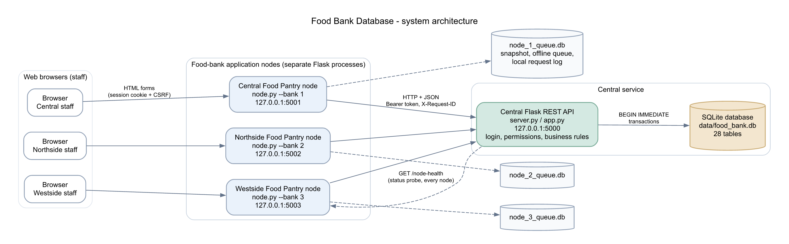
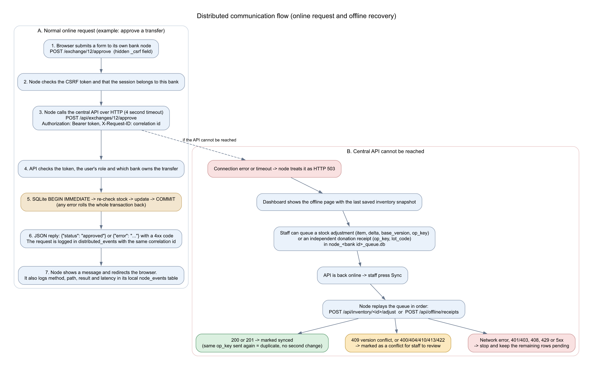
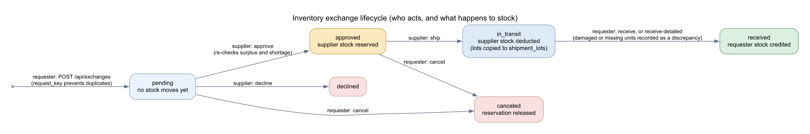

# System Architecture

This document explains how the Food Bank Database is built as a set of communicating processes, how data stays consistent, and what happens when parts of the system fail. Everything here matches the current code. File names are given so you can check each point.



## 1. Components

| Component | File(s) | Port (local demo) | Role |
| --- | --- | --- | --- |
| Central Flask API | `server.py`, `app.py`, `routes/`, `services/` | 5000 | Owns the database. Handles login, permissions and every business rule. |
| SQLite database | `data/food_bank.db` (or `FOOD_BANK_DB_PATH`) | none | The single shared store for all banks |
| Food-bank nodes | `node.py --bank N` | 5000 + N (5001, 5002, 5003) | One Flask web application per food bank. Serves HTML pages and calls the API. |
| Node queue files | `offline_queue.py`, `node_N_queue.db` | none | One small SQLite file per node for the offline snapshot, queued changes and a local request log |

`start_demo.py` starts the API and the three nodes as four separate operating-system processes. Docker Compose (`compose.yaml`) can run the same four processes as four containers on one host.

## 2. Central Flask API

`app.py` builds the API from ten route modules (blueprints): `auth`, `inventory`, `transfers`, `stats`, `admin`, `extensions`, `docs`, `advanced`, `stabilization` and `dbadmin`. The route functions are kept thin. The actual rules live in `services/` (for example `services/inventory.py`, `services/transfers.py` and `services/matching.py`).

For every request the API:

1. Reads the `X-Request-ID` header, or generates a correlation ID if the header is missing.
2. For protected routes, checks the `Authorization: Bearer <token>` header against `auth_tokens`. Only a SHA-256 hash of each token is stored. Tokens expire after 12 hours.
3. Checks the user's role (`require_login`, `require_roles(...)`, `require_admin` in `routes/common.py`). Most data is scoped to the user's own bank, which comes from the token and not from the request body.
4. Runs the operation, using a write transaction when it changes data.
5. Logs the method, path, status code, latency and correlation ID in `distributed_events`. The newest 5000 rows are kept. Request bodies, passwords and tokens are never logged.
6. Adds `X-Request-ID`, `X-Content-Type-Options`, `X-Frame-Options` and `Cache-Control: no-store` headers to the response.

## 3. SQLite database

There is one SQLite file with 28 tables (see `DATABASE_DICTIONARY.md`). `database.py` creates the original tables and `phase3_schema.py` adds the later ones. Both only add missing tables and columns. They never drop data. When an older database is upgraded, a backup copy is saved under `backups_before_upgrade/` first.

Every connection turns on `PRAGMA foreign_keys=ON` and waits up to 20 seconds when the database is locked (`busy_timeout`). Only the central API opens this file. Nodes never touch it.

Inventory is kept at two levels:

- `lots` holds each batch: quantity, expiration date, lot code and recall flag.
- `inventory` holds one row per bank and item. The row stores the total quantity (always recalculated from the lots), the target level and a `version` number. The version goes up every time the quantity changes.

## 4. Separate food-bank application nodes

Each node (`node.py`) is an independent Flask process configured for one bank ID. A node:

- serves the HTML pages for its bank (dashboard, additional features, system status, database administration),
- keeps a browser session holding the user's API token, username, role and bank ID,
- uses its own session cookie name (`foodbank_node_<id>`). Because of this, logging into Northside does not log you out of Central in the same browser,
- clears any session that was created for a different bank,
- requires a CSRF token (`_csrf` hidden field) on every POST form,
- never opens the central database. Every read and write goes through the API.

A node can show another bank's inventory, but only through `GET /api/banks/<id>/inventory`. For other banks, that endpoint returns only the item name, category, unit and the amount available to share. The node never receives the other bank's physical quantity, target or reservations, so it cannot leak them.

## 5. HTTP and JSON communication



Nodes call the API with `api_call()` in `node.py`. It uses Python's `urllib`:

- Request bodies are JSON (`Content-Type: application/json`), except CSV import, which sends `text/csv`.
- Every call has a **4 second timeout**.
- Every call gets a random correlation ID in the `X-Request-ID` header. The node writes the same ID, the method, path, result and latency to its local `node_events` table. The API writes the same ID to `distributed_events`. Anyone logged in can look up an ID on the **System status / traces** page (`GET /api/traces/<id>`). Non-admin users only see their own bank's requests.
- A reply with an HTTP error status becomes an `APIError` that carries the status code and the API's `error` message.
- A connection error or timeout becomes `APIError(503, "Central API is offline or not responding.")`.

The API also calls the nodes. `GET /api/nodes` sends a request to `http://127.0.0.1:<5000+bank_id>/node-health` for up to 30 banks, in parallel, with a 0.65 second timeout each. This is how the dashboard and admin pages know which nodes are online. In Docker, the address comes from `FOOD_BANK_NODE_URL_TEMPLATE` instead.

## 6. Inventory synchronization

There is one copy of the real inventory, in the central database. Nodes do not replicate it. "Synchronization" in this project means two things:

1. **Snapshot on every successful dashboard load.** When `GET /api/dashboard` works, the node saves a cut-down copy of its own bank's inventory (item ID, name, quantity, version) in its queue file. It is used only for the offline page.
2. **Replay of queued offline changes** when the API comes back (see section 7).

Changes made online are visible to all other nodes on their next page load, because every node reads from the same API. There is no push notification between nodes. Each bank sees new requests the next time it loads its dashboard.

## 7. Offline operations

When the API cannot be reached, the dashboard shows `offline.html` with the saved snapshot. Staff can queue two kinds of change in the node's queue file:

| Queued change | Sent on sync to | Conflict rule |
| --- | --- | --- |
| Stock adjustment (`item_id`, `delta`, `base_version`, `op_key`) | `POST /api/inventory/<id>/adjust` | **Strict.** If the item's current version is not `base_version`, the API returns 409 and changes nothing. Only one unsynced adjustment per item is allowed. |
| Independent donation receipt (`item_id`, `quantity`, `donor`, `lot_code`, `op_key`) | `POST /api/offline/receipts` | **Merges.** A new donation is a new lot, so adding it is safe even if the item changed in the meantime. |

When staff press **Sync**, the node sends queued rows in order (`offline_queue.sync_pending` and `sync_receipts`):

- **Success (200/201):** the row is marked `synced`. The `op_key` is saved centrally (`sync_operations` or `offline_receipts`). Sending the same key again returns `duplicate: true` and changes nothing, so a retry after a lost reply cannot apply a change twice.
- **409, or 400/404/410/413/422:** this change can never succeed as sent, so the row is marked `conflict` with the reason and left for a person to review. The node then moves on to the next row, so one bad row does not block the rest.
- **Network error, 401, 403, 408, 429 or 5xx:** the problem might be temporary, so syncing stops and the rest of the rows stay `pending`.

Staff can discard a pending or conflicting row. Queue files never store passwords or tokens. Transfers, new items and most other actions cannot be queued and need the API.

For classroom demonstrations, each node has a **Simulate connection outage** control on the **Offline sync** page (`/offline`). It makes the node act as if the API were unreachable, and affects every user of that node until it is switched back. Because of that, `simulate_offline` in `node.py` only accepts a request when all of the following are true:

1. Classroom demo mode is on (`FOOD_BANK_DEMO_MODE=1`, set by the launchers). Otherwise the node returns 404.
2. The request comes from the same computer (loopback address). Otherwise it returns 403.
3. The user is logged in (otherwise 401) and has the `admin` role (otherwise 403).
4. The form has a valid CSRF token (otherwise 400).

The outage state changes only after every check has passed. Every attempt, allowed or refused, is written to the node's local `node_events` log with the user, role and address, and to the node's console log. The button is only shown to users who are allowed to use it. On the offline page during a *real* outage, "Retry central API connection" is a plain reload link, so it can never switch the simulation on by mistake.

## 7a. Classroom demo mode and accounts

The public demo passwords (`demo123`, `admin123`) are a classroom convenience, so they are tied to an explicit setting:

- `initialize()` in `database.py` creates the demo `staff` accounts and the `admin` account only when demo mode is on, or when a demo tool asks for them explicitly (`seed_more_demo_data.py`, the test lab, the scripted story and the benchmark, which all use their own temporary or demo databases). Outside demo mode a new database has no accounts, and an existing database never gets an `admin` added silently.
- `POST /api/login` refuses a correct demo password with HTTP 403 when demo mode is off, and the refusal is recorded in `audit_events`. Admins also cannot set a demo password for a new account outside demo mode.
- `manage_accounts.py` creates the first administrator or replaces a password from the command line. Passwords are typed at a hidden prompt, must be at least 10 characters, and changing a password ends that user's sessions.

Passwords are stored as salted PBKDF2-SHA256 hashes (240,000 iterations), and login tokens only as SHA-256 hashes. The node keeps the token in its signed, HttpOnly, SameSite=Lax session cookie and never puts it in a page. `FOOD_BANK_SECURE_COOKIES=1` adds the `Secure` flag when the nodes are served over HTTPS.

## 8. Error handling

- **Business rule errors** are raised as `Problem(message, status)` in the services. `app.py` turns them into `{"error": "..."}` with that status, and records the failure in `audit_events`.
- **Unknown routes and wrong methods** return JSON 404 and 405.
- **Bad input** (missing fields, wrong types, values out of range, a body that is not a JSON object) returns 400.
- **Request bodies over 2 MB** are rejected with a JSON 413 error (`MAX_CONTENT_LENGTH`).
- **Unexpected server errors** return a JSON 500 with only a generic message and the request ID. The details go to the server log, never to the client.
- **On the node**, API errors are shown to the user as a flash message. A 401 clears the session and sends the user to the login page. A 503 on the dashboard shows the offline page.
- **Repeated login failures** return 429 after eight failed attempts for the same username at the same bank within 15 minutes.

Status codes are listed in `API.md`.

## 9. Transaction consistency

All changes go through `write_db()` in `database.py`:

```python
con.execute('BEGIN IMMEDIATE')   # take the database write lock right away
...                              # re-read current values, check the rules, write
con.commit()                     # or rollback() on any exception
```

`BEGIN IMMEDIATE` means only one write transaction runs at a time, and it re-reads the latest data after getting the lock. This is how the project avoids double-booking:

- **Approving a transfer** re-checks, inside the transaction, that the supplier's unreserved usable stock above target is still at least the requested amount, and that the requester still needs it. If two banks try to claim the same surplus at the same moment, the second approval sees the first reservation and gets 409.
- **Shipping** removes stock from the supplier's unexpired, non-recalled lots, oldest expiration first, and records which lots were sent in `shipment_lots`.
- **Receiving** adds those same lots (with their expiration dates and lot codes) to the requester.
- **State changes** only work from the right starting state (see `TRANSITIONS` in `services/transfers.py`). Repeating `ship` or `receive` gets 409 instead of moving stock twice.
- **Creating a transfer** needs a `request_key`. Sending the same key and the same details again returns the original transfer (`created: false`). The same key with different details gets 409.
- **CSV import** checks every row first and commits all of them or none.
- If any step throws an error, the whole transaction rolls back, so the database is never left halfway through a change.



## 10. Failure scenarios and central-server limitations

| What fails | What happens |
| --- | --- |
| One bank node stops | The API and the other nodes keep working. `GET /api/nodes` shows that node as offline. Restarting it brings it back, and its queue file is still there. |
| The central API stops | Every node loses live data. Each node shows its last snapshot and can queue stock adjustments and donation receipts. Nothing else works until the API is back. |
| The network is slow | Node calls give up after 4 seconds and act as if the API is offline. The user can retry. |
| A reply is lost after the API already made the change | Transfer requests and queued offline changes carry keys, so retrying them is safe. Other actions (for example approve or ship) are protected by state checks, so a retry gets 409 instead of being applied twice. |
| Two users change the same data at once | SQLite write transactions run one at a time, and the rules are re-checked inside each one. |
| The database file is damaged | The admin health check and `integrity_check` will report it. Recovery is a manual restore from a verified backup (`DATABASE_MAINTENANCE.md`). There is no automatic recovery. |
| The Docker host stops | All containers stop, because they all run on one machine. |

**The central server is a single point of failure.** The project has no replication, failover, consensus or leader election. We chose this on purpose to keep the data model simple and consistent, and to keep the project a reasonable size for a semester. Because there is only one copy of the data, there is never a question of which copy is correct. The cost is availability: if the API or the database is down, the system cannot process transfers. Section 12 of `FINAL_TECHNICAL_REPORT.md` discusses what it would take to remove this limitation.
