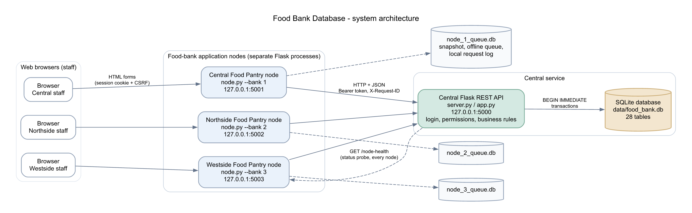
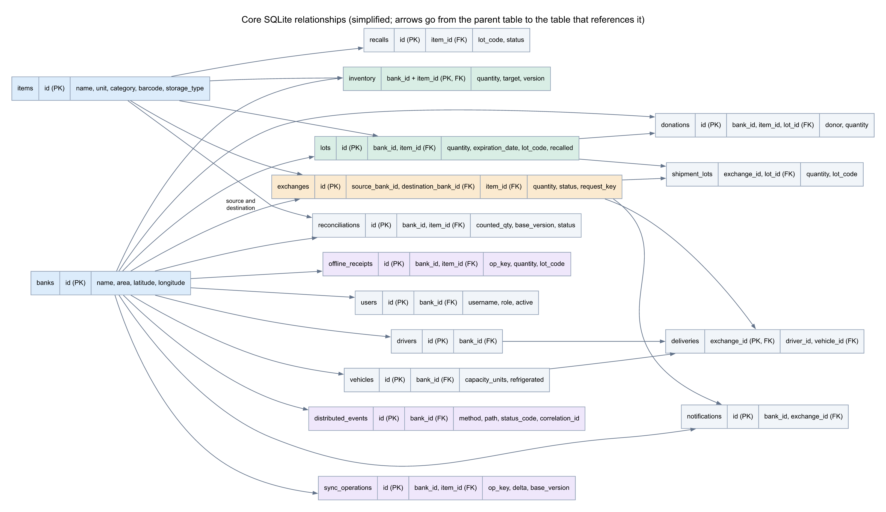
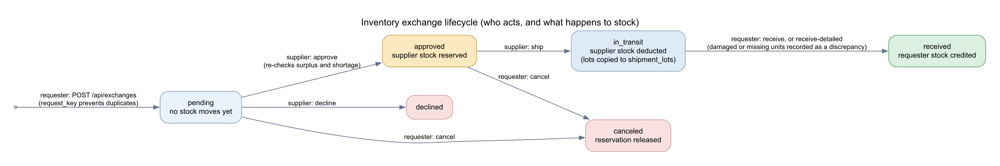
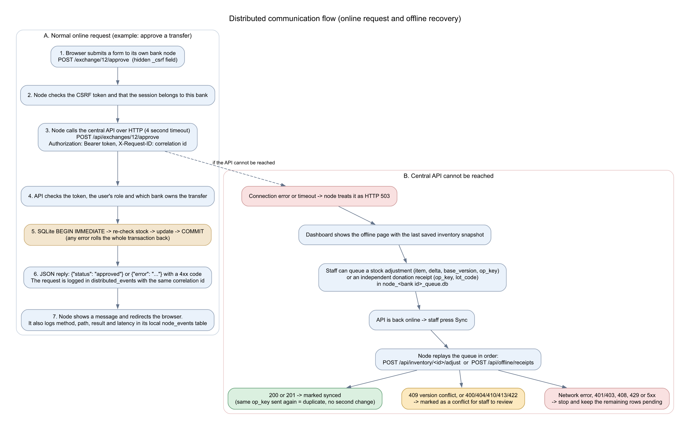

# System Diagrams

All diagrams are in `docs/diagrams/`. Each one comes in three files:

- `.dot` is the **editable source** (Graphviz DOT, plain text)
- `.svg` is a scalable image, good for the report
- `.png` is a raster image, good for slides

## 1. System architecture



Source: `diagrams/system_architecture.dot`

Three food-bank nodes, each a separate Flask process, serve their own staff's browsers. Every node calls the central Flask API over HTTP with JSON. Only the API opens the SQLite database. Each node has its own small queue file for its offline snapshot, queued changes and request log. The dashed arrow from the API shows the `/node-health` check that the API sends to every node.

## 2. Database relationships



Source: `diagrams/core_data_model.dot`

This shows the main tables and their foreign keys. Arrows go from the parent table (for example `banks`) to the table that references it (for example `inventory`). The purple tables support the distributed features: offline replay protection and request tracing. Login tokens, audit records, donors, waste, storage zones and backups are left out to keep it readable. All 28 tables are listed in `DATABASE_DICTIONARY.md`.

## 3. Inventory exchange lifecycle



Source: `diagrams/transfer_lifecycle.dot`

These are the states of a transfer, which bank performs each action, and when stock is reserved, removed and added. The states match the `TRANSITIONS` table in `services/transfers.py`.

## 4. Distributed communication flow



Source: `diagrams/distributed_communication.dot`

Part A follows one request (approving a transfer) from the browser through the node, the API and the database, and back. Part B shows what happens when the API cannot be reached: the node shows its offline page, queues changes, and later replays them. It also shows how each kind of reply is handled during sync.

## Editing and regenerating the images

1. Edit the `.dot` file in any text editor.
2. Regenerate the images with Graphviz (https://graphviz.org/download/):

   ```powershell
   cd docs\diagrams
   dot -Tsvg system_architecture.dot -o system_architecture.svg
   dot -Tpng -Gdpi=150 system_architecture.dot -o system_architecture.png
   ```

   Repeat for each diagram. If Graphviz is not installed, you can paste the `.dot` text into an online Graphviz viewer and export the image from there.

3. Check that the labels still match the code (ports, table names, state names).
