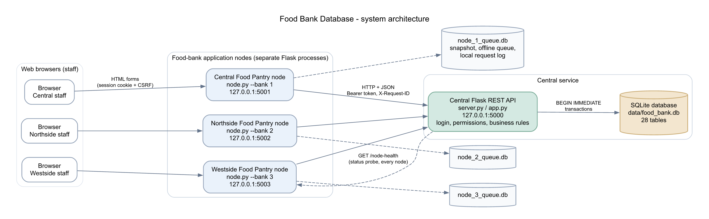
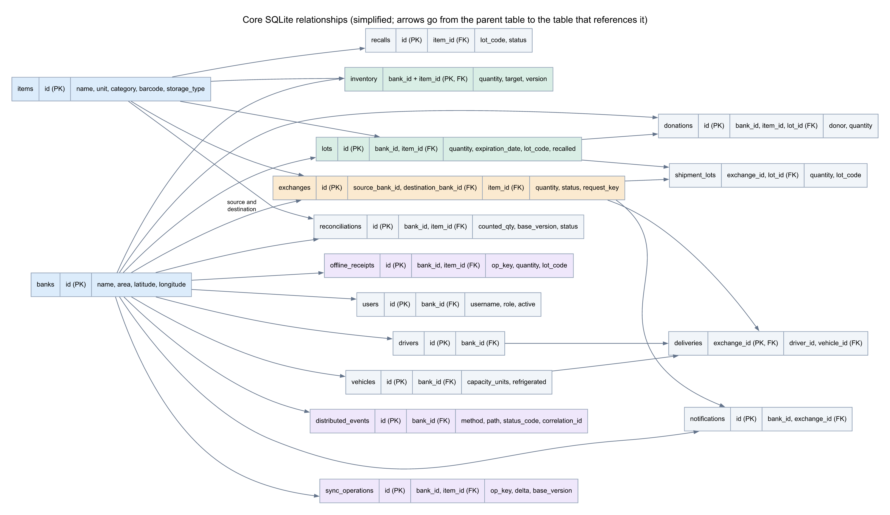
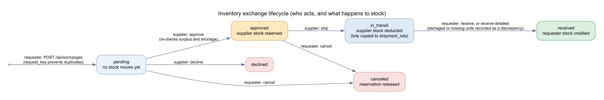

# Food Bank Database: A Distributed Inventory and Exchange System

**Course:** Distributed Computing, Fall 2026
**Team:** Kaitlin Albey, Alec Fox, Corey Rodgers, Daniel Aldama, Brenden Riddle
**Repository:** https://github.com/kaitlinalbey/food-bank

## Abstract

Food banks in the same area often have uneven inventory. One location runs short of an item that another location has more of than it needs. This project is a prototype system that lets separate food banks track their own inventory, find matching surpluses at other banks, and move food between locations through a tracked request, approval, shipping and receipt process. The system has three independent Flask web applications, one per food bank, that communicate over HTTP and JSON with a central Flask API backed by a SQLite database. We focused on distributed-computing problems that come up even in a small system: lost connections, retried requests, two users changing the same data at once, and offline work that has to be merged later. On a Windows 11 test machine, all 156 automated tests passed, all 8 built-in failure scenarios passed, and all 18 live multi-process scenarios passed (148 of 148 checks). The main limitation is that the central API and database are a single point of failure.

## 1. Introduction and project background

Food banks collect donated food and give it to people in need. In a city with several food banks, each one manages its own stock. Donations do not arrive evenly, so a pantry might have far more canned beans than it can use while another pantry nearby has none. Today, finding out who has what usually means phone calls, emails or shared spreadsheets.

Our team chose this problem because it naturally fits a distributed system. Each food bank is a separate organization with its own staff, its own computer and its own view of the data. They still need to share some information and coordinate actions that affect more than one location. All food banks, donors and quantities in this project are fictional.

## 2. Problem statement

We wanted to answer this question: *How can several independent food banks share inventory information and transfer food between each other in a way that stays correct when the network or a server fails, and when more than one person acts at the same time?*

Specific problems the system has to handle:

- Each bank must control its own inventory, while other banks can see what is available to share.
- The same extra stock must not be promised to two banks.
- Repeating a request, for example after a timeout, must not create a second transfer or move stock twice.
- A bank should be able to keep some work going when it loses its connection, without corrupting data when it reconnects.
- People need to be able to see what happened, including which requests failed and why.

## 3. Project goals

1. Keep separate inventory for each food bank, including targets, batches (lots) and expiration dates.
2. Automatically find which shortages at one bank could be filled by extra stock at another.
3. Support a full transfer process: request, approve, ship and receive, plus decline and cancel.
4. Run each food bank as its own process, communicating only through a network API.
5. Keep inventory numbers correct under concurrent requests, retries and partial failures.
6. Allow limited offline work and safe synchronization afterward.
7. Provide automated tests and repeatable demonstrations of failure handling.

## 4. System architecture

The system has four running processes in the standard setup:

- **Central API** (`server.py`, port 5000): a Flask application that owns the SQLite database. It handles login, checks permissions and applies all inventory and transfer rules.
- **Three food-bank nodes** (`node.py --bank 1/2/3`, ports 5001-5003): separate Flask applications, one per food bank. Each serves HTML pages to that bank's staff and calls the central API for every read and write. A node never opens the central database.

Each node also keeps a small local SQLite file holding a snapshot of its inventory, its queue of offline changes and a log of its own API calls.

We chose a **central coordinator** design instead of giving each bank its own full database. With one authoritative copy of the inventory, there is never a question of which copy is correct, and transfers can be checked in a single database transaction. The downside is that the central API and database are a single point of failure. Section 12 discusses this.

## 5. Technologies used

| Technology | Why we used it |
| --- | --- |
| Python 3 | Readable, and every team member could work in it |
| Flask 3 | Small web framework that works for both a JSON API and server-rendered pages |
| Jinja2 templates, plain HTML and CSS | No build tools, so the frontend is easy to redesign later |
| SQLite | Transactional database in a single file, with no separate server to install |
| HTTP and JSON (Python `urllib`) | Standard, language-neutral communication between nodes and the API |
| `unittest` | Built into Python, so no extra dependencies |
| Docker Compose (optional) | Runs the same four processes as containers |
| Graphviz | Editable text-based diagrams |

The only third-party dependency is Flask.

## 6. Database design

The central database has 28 tables. The core design separates four ideas:

- **`banks`**: the participating food banks, with map coordinates used for distance.
- **`items`**: one shared catalog of food types, so "Rice (bags)" means the same thing at every bank.
- **`inventory`**: one row per bank and item, with total `quantity`, `target` level and a `version` number.
- **`lots`**: the actual batches of stock, each with its own quantity, expiration date, lot code and recall flag.

`inventory.quantity` is always recalculated from the lots, so the two cannot disagree. The `version` number goes up on every quantity change, and the offline sync uses it to detect stale updates.

Transfers are stored in **`exchanges`** (source bank, destination bank, item, quantity, status and a unique `request_key`). **`shipment_lots`** records exactly which lots were shipped, so the receiving bank gets the same expiration dates and lot codes. This also lets a recall follow a batch from one bank to another.

Tables that support the distributed features:

- **`sync_operations`** and **`offline_receipts`** store the operation key of every synced offline change, so a replayed change is recognized and not applied twice.
- **`distributed_events`** logs every API request with its correlation ID, path, status code and latency.
- **`auth_tokens`** stores only SHA-256 hashes of login tokens.

Other tables cover users, notifications, activity history, audit events, donors, donations, waste, recalls, storage zones, physical counts, drivers, vehicles, deliveries, discrepancies and backups. The full list is in `DATABASE_DICTIONARY.md`. Foreign keys are enforced (`PRAGMA foreign_keys=ON`).

## 7. Implementation methods

**Layering.** The API code is split into `routes/` (HTTP handling, input parsing and permission decorators) and `services/` (business rules). Route functions are short. They call a service function and return its result as JSON. This let us test the rules directly, without HTTP.

**Authentication and authorization.** Users log in to a specific bank. The API returns a random token and stores only its SHA-256 hash, with a 12-hour expiry. Each protected route uses a decorator (`require_login`, `require_roles(...)` or `require_admin`). The bank a user acts for always comes from their token, never from the request body. The node stores the token in its session cookie. The node's HTML forms are protected by a CSRF token.

**Node-to-API calls.** `api_call()` in `node.py` sends JSON over HTTP with a 4 second timeout and a random `X-Request-ID`. HTTP errors become an `APIError` with the status code and message. Connection failures become status 503, which the node uses to switch to its offline page.

**Transactions.** Every change runs inside `write_db()`, which starts with `BEGIN IMMEDIATE` and either commits everything or rolls everything back.

**Schema changes.** New features added tables and columns over time. The schema code only adds missing tables and columns, and it makes a backup copy before upgrading an older database file.

**Frontend.** Pages are rendered on the server with Jinja2 templates and use a single plain stylesheet. This keeps all business logic in the API and makes a later redesign straightforward (see `FRONTEND_HANDOFF.md`). Each node is a multi-page website with a sidebar: Dashboard, My inventory, Other food banks, Supply matching, Transfers, Donations and waste, Batches and recalls, Transportation, Offline sync, System status, More tools and Administration (see `MULTIPAGE_NAVIGATION.md`).

## 8. Distributed computing concepts

**Separate processes and message passing.** Each food bank is an independent process with its own memory, sessions and local storage. The only way nodes share information is by sending HTTP requests with JSON bodies to the API. In the standard setup, nodes do not talk to each other directly.

**Centralized coordination.** The API acts as the coordinator and the database as the single source of truth. All checks that involve two banks, such as "does the supplier still have enough extra?", happen in one place, inside one transaction.

**Partial failure.** One node can stop while the others keep working. The API checks each node's `/node-health` address with a short timeout and reports which are online. If the API stops, each node notices the connection failure and switches to a limited offline mode instead of crashing.

**Idempotency.** Networks can lose a reply after the server has already done the work, so clients retry. We made retries safe by giving each create-type operation a unique key chosen by the client: `request_key` for transfers and `op_key` for offline changes. The server remembers keys it has processed. A repeat with the same key and details returns the original result. The same key with different details is rejected.

**Concurrency control.** SQLite allows one writer at a time. `BEGIN IMMEDIATE` takes the write lock at the start of the transaction, so the rules are checked against the latest data. Two approvals competing for the same stock run one after the other. The second one sees the first reservation and fails with 409.

**Optimistic concurrency for offline work.** An offline stock adjustment records the item version it was based on. When it syncs, the API only applies it if the version has not changed. Otherwise the change is held for a person to review. This is a version-check (compare-and-set) approach. We chose it because two people automatically combining physical stock corrections could easily produce a wrong count.

**Commutative operations.** A new donation received offline is different from a correction. It always adds a new lot and never overwrites anything, so the order does not matter. Offline donation receipts are therefore merged without a version check, but still use an operation key so they are only applied once.

**Observability.** Each node request has a correlation ID that both the node's local log and the central `distributed_events` table record. One request can be followed across both processes.

## 9. Inventory and exchange algorithms

### Usable stock, surplus and shortage

For a bank *b* and item *i* (see `services/inventory.py`):

- `usable` = sum of lots that are not expired and not recalled
- `reserved` = sum of quantities in approved transfers *from* bank *b* that have not shipped yet
- `surplus` = max(0, `usable` − `target` − `reserved`)
- `shortage` = max(0, `target` − `usable` − incoming transfers that are approved or in transit)

Both formulas use only stock that is actually safe to hand out, so expired or recalled food never hides a shortage and is never offered to another bank. Shortage subtracts deliveries already on the way, so a bank is not shown the same shortage twice. An earlier version used the total quantity (including expired units) for the shortage. We found and fixed this during final testing and added regression tests for it.

### Matching and score

For each item where a bank has a shortage, `services/matching.py` looks at every other bank with a surplus of that item and calculates:

- straight-line distance in miles (haversine formula) from the banks' coordinates
- `suggested_quantity` = min(shortage, surplus)
- `urgency` = max(0, 14 − days until the supplier's earliest expiration), if that date is today or later, otherwise 0
- `score` = max(0, 100 − 2 × miles) + min(15, urgency) + (`suggested_quantity` / shortage) × 10

The score favors closer banks, food that should be used soon, and suppliers who can cover more of the shortage. It is a simple rule-based ranking that helps staff choose, not an optimization. Results can be limited with `max_miles`.

### Transfer state machine

Each action is allowed only from certain states and only for one side of the transfer (`TRANSITIONS` in `services/transfers.py`):

| Action | From | To | Who | Stock effect |
| --- | --- | --- | --- | --- |
| request | (new) | pending | requester | none |
| approve | pending | approved | supplier | reserve (re-checks surplus and shortage) |
| decline | pending | declined | supplier | none |
| cancel | pending or approved | canceled | requester | releases the reservation |
| ship | approved | in_transit | supplier | removes lots, earliest expiration first |
| receive | in_transit | received | requester | adds the shipped lots |

Shipping uses **first-expiring, first-out**. It takes from the usable lots with the earliest expiration date first, and records each lot in `shipment_lots`. Receiving copies those lots to the destination, keeping their dates and codes. A detailed receipt can accept fewer units than were shipped and records the difference as a discrepancy.

### Offline queue replay

When a node syncs (`offline_queue.py`), it sends queued rows in the order they were created. Each reply is handled like this:

- success: mark the row synced
- 409, or another error that means the change can never succeed (400, 404, 410, 413, 422): mark it as a conflict and continue with the next row
- network error, authentication problem, rate limit or server error: stop and keep the remaining rows pending for a later try

## 10. Testing and results

All results below come from runs on one Windows 11 computer with Python 3.13.3 and Flask 3.1.3, using temporary databases with fictional data. The normal `data/food_bank.db` was not used.

### 10.1 Automated tests

`python -m unittest discover -s tests` ran **156 tests: 156 passed, 0 failed, 0 errors, 0 skipped** (about 2.5 minutes). The tests cover:

- inventory rules, reservations, lots, expiration, waste and donations
- the full transfer lifecycle, invalid state changes and duplicate requests
- concurrent approvals competing for the same stock
- offline queue behavior, including conflicts and keeping going after a rejected row
- login, roles, bank scoping and CSRF protection
- separate session cookies for nodes on the same host
- search and filter rules, and hiding other banks' private fields
- database administration: backups, isolated restore tests and health checks
- live HTTP tests that start a real API server and node
- regression tests for defects found in final testing (section 11)
- the multi-page web interface: every page for every role, hidden controls still refused by the server, redirects after forms, sorting, old links and the offline pages
- security: the administrator-only outage control, demo accounts only in demo mode, direct cross-bank and privilege-escalation attempts through the API, and error responses without internal details

### 10.2 Release check

`python release_check.py` reported:

| Check | Result |
| --- | --- |
| Automated tests | 156 passed, 0 skipped, 0 failures, 0 errors |
| Built-in test lab (8 scenarios on temporary databases) | 8 / 8 passed |
| Scripted transfer story (donation through receipt, plus an outage) | 7 / 7 steps passed |
| SQLite concurrency benchmark (5, 10, 20 banks) | 3 / 3 cases correct |
| Docker Compose configuration syntax | valid |

### 10.3 Live distributed verification

`python verify_distributed.py` starts the real API and three real node processes on unused ports with a new temporary database. It then drives 18 scenarios over HTTP. Result: **18 of 18 scenarios passed, 148 of 148 checks passed**, no timeouts, and no processes or ports left open afterward. Every check is listed in `DISTRIBUTED_VERIFICATION.md`. The scenarios were:

1. Start the API and three separate nodes
2. Each node logs in and reads its own inventory
3. A change at one bank is visible, correctly, from another
4. A transfer from request through receipt across nodes
5. One node disconnects while the others keep working
6. Supported offline actions are queued safely
7. Reconnect and synchronize
8. Stale updates are detected as conflicts
9. Repeated additive operations are applied once
10. Simultaneous requests for the same supplies
11. Retried API calls do not duplicate transfers
12. The central API is stopped and restarted
13. Failed operations give clear errors and the system recovers
14. Controlled load with 5, 10 and 20 banks
15. Backup and isolated restore checks
16. Node health, trace IDs, status endpoints and event logs
17. Only administrators can simulate an outage, and recovery works
18. Each bank searches its inventory independently, with no cross-bank edits

In scenario 12, the API process was actually stopped. The node returned its offline page (HTTP 503) with the saved snapshot, accepted a queued change, and reported a clear error when sync was attempted during the outage. After the API restarted, the existing login still worked and the queued change synced. In scenario 17:
- a staff user got 403 trying to start the simulated outage, and so did a viewer; a logged-out browser got 401;
- the node stayed online after each refused attempt;
- the administrator switched the outage on and off;
- staff could not end it;
- every attempt was written to the node's log.

The test log contains 16 HTTP 503 responses, all expected node responses during the outage scenarios: 13 offline pages and 3 health checks. There were no server tracebacks.

### 10.4 Load measurements

Scenario 14 sent concurrent HTTP requests through the API with one client per bank. Results from the final run:

| Banks | Requests | Errors | Throughput | Median latency | 95th percentile | Final quantities correct |
| --- | --- | --- | --- | --- | --- | --- |
| 5 | 100 | 0 | 35.9 req/s | 98 ms | 323 ms | yes |
| 10 | 200 | 0 | 35.2 req/s | 187 ms | 643 ms | yes |
| 20 | 400 | 0 | 36.4 req/s | 280 ms | 1537 ms | yes |

Earlier runs on the same machine measured between 34.4 and 43.9 req/s, so the numbers vary from run to run. Throughput stayed about the same as clients were added, while latency went up. This is what we expected, because every request goes through one process and one SQLite write lock. Correctness held at every size. These numbers come from one laptop over the loopback network, so they say nothing about performance across a real network.

### 10.5 Database and page checks

- **Database quality (22 of 22 checks passed):** SQLite `integrity_check` and `foreign_key_check`; inventory totals equal lot totals; no negative quantities; shipped lots equal transfer quantities; reservations block lowering stock; expired and recalled lots are excluded from usable stock; verified backup and isolated restore; data still present after restarting the API; the database file can be renamed right after use (no connections left open on Windows); and a copy of an older prototype database upgrades cleanly, keeps its old tables, makes backups once, and leaves the original file unchanged.
- **Page crawl:** with the API and three nodes running, every node page was loaded as staff (all three banks), admin, manager, dispatcher and viewer. Every link and form target was checked against the node's routes. Result: 0 broken links or form targets, every POST form has its CSRF field, no duplicate element IDs, non-admins get 403 on the administration page, a viewer gets no edit forms, and the server logs contain no errors.

- **Security probes:**
  - 55 direct API attempts to read or change another bank's data, or to use admin functions without the admin role, were all refused or correctly limited to the user's own bank.
  - 3,366 malformed API requests caused no server errors and revealed no internal details.
  - 4,644 malformed node form requests found no crash caused by form input.
- **Outside demo mode (live):** a new database got no accounts, and on a copy of a demo database the demo passwords were refused (403 and audited).

### 10.6 Not tested

- **Docker on other hosts.** The Compose setup was started and checked with `verify_docker.py` on one Windows computer with Docker Desktop, but not on Linux or macOS.
- **Separate computers.** All processes ran on one machine.
- **Visual layout and accessibility.** Pages were checked automatically for broken links and forms, and for horizontal overflow at 375, 768 and 1280 px in headless Chrome, but not with a screen reader or on real phones.

## 11. Challenges and solutions

| Challenge | Solution |
| --- | --- |
| Any logged-in user could start the outage simulation, which affects everyone on that node. Also, the demo `admin`/`admin123` account was created in any database without an admin. | The outage control was limited to administrators in classroom demo mode on the same computer, with logging. Demo accounts are now created and accepted only in an explicit demo mode, and a command-line tool sets real passwords. Both are covered by regression tests and a live scenario. |
| Two banks approving requests for the same extra stock at the same time could promise it twice. | Approval re-checks the available surplus inside a `BEGIN IMMEDIATE` transaction, so approvals run one after another. A test fires competing approvals at once. |
| A user retrying after a timeout could create duplicate transfers. | Clients send a unique `request_key`. The server returns the original transfer for a repeat, and rejects a reused key with different details. |
| Offline changes might be based on old data. | Stock adjustments carry the item's `version`. A mismatch returns 409 and the change is held for review instead of being applied. |
| One invalid queued change stopped every later change from syncing. | The node now marks changes that can never succeed as conflicts and moves on. It only stops on errors that might be temporary. |
| All three nodes run on 127.0.0.1. Browsers share cookies across ports, so logging into one node logged you out of the others. | Each node uses its own session cookie name, and a session is only accepted by the node for the bank it was created for. |
| On Windows, SQLite files stayed locked after use, which broke cleanup in tests and backups. | Every connection is now closed explicitly, even when an error happens. |
| Other banks should see what they could request, but not private details. | The API removes private fields (physical quantity, target, reservations, lot details) before returning another bank's inventory. |
| A bank whose stock had all expired showed no shortage, because the shortage formula used total quantity. | The shortage now uses usable stock (not expired, not recalled). Regression tests check expired and recalled cases. |
| Two dashboard forms had small problems: the batch-expiry form only worked with JavaScript turned on, and the "Add user" form only offered two roles. | The node now reads the batch number from the form when the script does not run, and the form lists all six roles. |
| The single dashboard page had grown too long, and its "Add item" form also sent the hidden category filter, so new items were rejected with an empty category. | The interface was split into separate pages with a sidebar. Old links are forwarded through fixed tables, and each form returns to its own page. The add-item form now has one category field, with a regression test. |
| Demos kept changing the shared data. | The presentation launcher creates a new database for every session. The test lab and verification scripts always use temporary databases. |

## 12. Limitations

- **Single point of failure.** If the central API or its database is unavailable, no transfers can be processed. There is no replication, failover or leader election.
- **One machine.** In our tests, every process ran on the same computer. Docker Compose also runs on one host.
- **Limited offline mode.** Only stock adjustments and new donation receipts can be queued. Requests, approvals, shipping and receiving need the API.
- **Serialized writes.** Every API request writes a log row, so even reads briefly take the database write lock. In our tests, throughput stayed between about 34 and 44 requests per second no matter how many clients were added.
- **Simple matching.** Distance is a straight line between sample coordinates. There is no routing, traffic or delivery cost.
- **Classroom security.** The demo passwords are public. They only work in an explicit classroom demo mode, but the launchers always turn that mode on. There is no HTTPS, and there has been no independent security review. Login throttling is per account, so someone could lock out a known username.
- **Simplified food safety.** Recalls, storage types and vehicle capacity are basic models, not compliance tools.
- **User interface.** Tables have no pagination. Some roles have no specific screens. For example, drivers have no task view.

## 13. Future improvements

1. **Remove the single point of failure.** Run a standby copy of the API with a replicated database (for example PostgreSQL with streaming replication), with automatic failover.
2. **Run nodes on separate machines** and use HTTPS between nodes and the API.
3. **Expand offline mode** to approving or receiving transfers, with clear conflict rules for each action.
4. **Push updates to nodes** (for example with WebSockets or server-sent events) instead of waiting for the next page load.
5. **Stop logging inside the main write lock**, or move request logs to a separate store, so read requests can run in parallel.
6. **Better matching**, using real road distances and letting one request be split across several suppliers.
7. **Security hardening:** required password change for default accounts, HTTPS, per-IP rate limits, and a security review.
8. **Frontend redesign** and pages for the dispatcher and driver roles.

## 14. Conclusion

We built a working prototype in which three independent food-bank applications coordinate through a central API to share inventory and move food between locations. The project showed us that even a small distributed system has to deal with timeouts, retries, concurrent updates and partial outages, and that each needs a deliberate design: idempotency keys, transactional checks, version numbers, and a clear choice of which operations are safe to do offline. Our tests, including live runs with real separate processes, show that the system keeps inventory numbers correct in all the scenarios we tried. The main design trade-off is the central coordinator. It keeps the data consistent and the code simple, but if it fails, the system cannot process transfers. Removing that limitation would be the next major step.

## 15. References

1. M. van Steen and A. S. Tanenbaum, *Distributed Systems*, 4th ed. distributed-systems.net, 2023.
2. M. Kleppmann, *Designing Data-Intensive Applications*. O'Reilly Media, 2017.
3. R. T. Fielding, "Architectural Styles and the Design of Network-based Software Architectures," Ph.D. dissertation, University of California, Irvine, 2000.
4. SQLite documentation, "Transaction" (BEGIN DEFERRED / IMMEDIATE / EXCLUSIVE). https://www.sqlite.org/lang_transaction.html
5. Flask documentation (version 3.x). https://flask.palletsprojects.com/
6. Python documentation, `sqlite3` module and `urllib.request` module. https://docs.python.org/3/library/
7. Graphviz documentation. https://graphviz.org/documentation/

Background sources on food bank distribution (from the team's original proposal. Confirm authors, titles and years, and format them in the required citation style before submitting):

8. Project MUSE article: https://muse.jhu.edu/pub/1/article/873630
9. SSRN paper: https://papers.ssrn.com/sol3/papers.cfm?abstract_id=5455454
10. C. Prendergast, NBER conference paper on food bank allocation: https://conference.nber.org/confer/2015/MDf15/Prendergast.pdf

Related project documents: `README.md`, `ARCHITECTURE.md`, `API.md`, `DATABASE_DICTIONARY.md`, `TEST_PLAN.md`.
